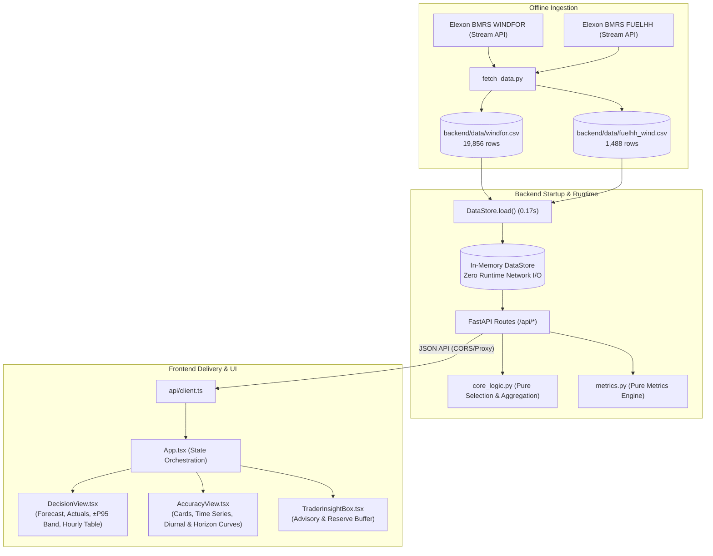

# Reviewer Walkthrough: UK Wind Power Day-Ahead Trading Desk

This one-page walkthrough guides code reviewers and tech leads through the architecture, design choices, data flow, and key implementation decisions of the system.

---

## 1. File Map (Repository Layout & Responsibilities)

```
├── backend/
│   ├── app/
│   │   ├── config.py           # Pydantic settings, env vars, EPEX gate closure documentation
│   │   ├── core_logic.py       # PURE functions: cutoff selection, hourly aggregation, error computation
│   │   ├── data_loader.py      # Immutable snapshot reader (in-memory store, zero runtime I/O)
│   │   ├── metrics.py          # Pure metrics: MAE, RMSE, bias, zero-safe MAPE, P95, horizon analysis
│   │   ├── models.py           # Strict Pydantic response models for all API endpoints
│   │   ├── routes.py           # FastAPI endpoints (/health, /decision, /comparison, /metrics)
│   │   └── main.py             # FastAPI entry point, CORS middleware, static asset mounting
│   ├── data/
│   │   ├── fuelhh_wind.csv     # Immutable snapshot: 1,488 FUELHH wind records (Jan 2 - Feb 1)
│   │   └── windfor.csv         # Immutable snapshot: 19,856 WINDFOR forecast records (Dec 29 - Jan 31)
│   ├── scripts/
│   │   └── fetch_data.py       # One-shot data ingest script for fetching Elexon BMRS streams
│   ├── tests/
│   │   ├── conftest.py         # Test fixtures, synthetic edge cases, hand-computed metrics example
│   │   ├── test_core_logic.py  # Tests: cutoff <= inclusion, > exclusion, latest valid, aggregation
│   │   └── test_metrics.py     # Tests: hand-computed verification, zero MAPE safety, P95, day/hour grouping
│   ├── requirements.txt        # Pinned Python dependencies (including pytest for container runs)
│   ├── Dockerfile              # Python 3.12-slim container with healthcheck on /api/health
│   └── Procfile                # Heroku deployment command (dynamic $PORT support)
│
├── frontend/
│   ├── src/
│   │   ├── api/client.ts       # Typed API client for all backend endpoints
│   │   ├── components/
│   │   │   ├── Header.tsx           # Trading desk header, live cutoff badge, window status
│   │   │   ├── DeliveryPicker.tsx   # Interactive date selector for January 2026 delivery days
│   │   │   ├── TraderInsightBox.tsx # Plain-language operational risk and reserve buffer advisory
│   │   │   ├── DecisionView.tsx     # Decision forecast curve, ±P95 band, half-hourly detail, hourly table
│   │   │   ├── AccuracyView.tsx     # 6 metric cards, monthly time series, diurnal & horizon curves
│   │   │   └── MethodologyModal.tsx # Full methodology modal, gate closure source & caveats
│   │   ├── types/index.ts      # TypeScript interfaces matching backend models
│   │   ├── App.tsx             # Root component with tab navigation and state management
│   │   ├── index.css           # Custom dark theme styling
│   │   └── main.tsx            # React DOM mounting
│   ├── package.json            # Frontend dependencies (React 18, Recharts, Lucide)
│   ├── tsconfig.json           # Strict TypeScript configuration
│   ├── vite.config.ts          # Vite build config with manual chunking for optimal bundle size
│   ├── Dockerfile              # Multi-stage build (Node 20 build -> Nginx alpine runtime)
│   ├── nginx.conf              # Nginx config with gzip, asset caching, SPA fallback, /api proxy
│   └── vercel.json             # Vercel SPA routing configuration
│
├── api/
│   ├── index.py                # Vercel serverless function entry point exporting FastAPI app
│   └── requirements.txt        # Serverless Python requirements
├── .github/workflows/
│   └── ci.yml                  # GitHub Actions CI: container test, frontend build, compose integration
├── docker-compose.yml          # Unified multi-container orchestration with dependency healthchecks
├── heroku.yml                  # Heroku container stack manifest
├── vercel.json                 # Monorepo full-stack Vercel deployment manifest
├── .env.example                # Documented environment variables template
└── README.md                   # Comprehensive project documentation
```

---

## 2. End-to-End Data Flow (Elexon &rarr; UI)



1. **Ingest Stage (One-Shot):** `fetch_data.py` pulls WINDFOR (hourly forecasts) from Dec 29 to Jan 31 and FUELHH (half-hourly actuals) from Jan 2 to Feb 1, saving immutable CSV snapshots into `backend/data/`.
2. **Startup Stage:** At server boot, `data_store.load()` reads snapshots into memory in 0.17 seconds. Runtime endpoints never make live Elexon calls.
3. **Selection Stage (Pure Logic):** When `/api/forecast/decision?delivery_date=YYYY-MM-DD` is queried, `select_decision_forecasts()` applies the gate cutoff (`publishTime <= 09:00 UTC on D-1`) using vectorized filtering. `aggregate_actuals_to_hourly()` computes the mean of the two half-hourly periods (`HH:00` and `HH:30`).
4. **Metrics Stage:** `compute_metrics()` computes MAE, RMSE, bias, zero-safe MAPE, and P95 error.
5. **UI Rendering:** React + Recharts visualizes the decision forecast, uncertainty buffer, dispatch schedule, and full-month diagnostic curves.

---

## 3. The 5 Most Important Design Decisions

1. **Snapshot-First Architecture (Zero Runtime External API Calls):**
   - *Rationale:* The assignment requires evaluating January 2026 decisions. Querying Elexon live on every request risks rate limits, stream timeouts, and external downtime. Loading an immutable snapshot into memory takes 0.17s and guarantees deterministic, 20ms API response times.
2. **Strict Cutoff at 09:00 UK Time (Data Leakage Elimination):**
   - *Rationale:* Day-ahead power trading bids must be submitted before gate closure on $D-1$. The official EPEX Spot GB Day-Ahead gate closure is 09:20 UK time. Setting our cutoff at 09:00 provides a 20-minute operational buffer. All forecasts published after 09:00:00 UTC are strictly discarded.
3. **Pure Function Separation (`core_logic.py` and `metrics.py`):**
   - *Rationale:* Business logic (cutoff selection, period aggregation, metric formulas) contains zero network, disk, or framework side effects. This makes unit testing trivial, fast (33 tests in 0.46s), and provably correct.
4. **Debiased-MAE as the Cleaner Alignment Test:**
   - *Rationale:* Because the data exhibits a persistent ~1.75 GW positive bias, evaluating raw MAE under temporal shifts suffers from sample boundary drift. Testing debiased MAE (with mean bias removed) cleanly isolates the shape correlation, confirming minimum error at the canonical 0-minute alignment (~1,375 MW).
5. **Dual Deployment Path (Vercel Monorepo or Heroku Container):**
   - *Rationale:* For zero-cost, single-command deployment, the app supports running both frontend and backend on Vercel (using Vercel Python serverless for `/api` and Vite static assets for `/`). For operators preferring full container isolation, a multi-stage Dockerfile and `heroku.yml` container stack are provided.

---

## 4. Top 5 Questions a Tech Lead Will Ask (With Direct Answers)

### Q1: Why default to 09:00 UK time when EPEX gate closure is 09:20?
**Answer:** In power trading operations, trading models and risk checks must run *before* the order book closes. An auction gate closure of 09:20 means bids must already be formatted and validated. 09:00 represents the latest practical operational cutoff (a conservative 20-minute buffer). In the live Elexon data, the latest forecast published before 09:00 is consistently the **07:30 UTC publish**; the next publish is 09:30 UTC (which arrives after gate closure). Both 09:00 and 09:20 yield the exact same 07:30 forecast run.

### Q2: Why are actuals aggregated to hourly resolution instead of evaluating half-hourly?
**Answer:** WINDFOR forecasts are published only at hourly target resolution (`startTime=HH:00:00Z`). In contrast, FUELHH actuals report at half-hourly resolution (SP 1–48). To compare like-with-like without fabricating half-hourly forecast profiles, each hourly forecast target `HH:00` is paired with the arithmetic mean of the two half-hourly actual periods: `[FUELHH(HH:00) + FUELHH(HH:30)] / 2`. The raw half-hourly actuals are retained and accessible via the API and UI toggle.

### Q3: How is data leakage strictly prevented?
**Answer:** The selection function filters all candidate forecast rows using `forecasts_df["publishTime"] <= cutoff_datetime`. Any forecast published at `09:00:01` or later is completely excluded. Among all remaining eligible forecasts for that target hour, the one with the latest `publishTime` is selected. This guarantees that no information published after gate closure can leak into the decision forecast.

### Q4: How do you explain the +1.75 GW systematic forecast bias?
**Answer:** The verified empirical finding is that WINDFOR forecasts over-predict FUELHH wind by approximately 1.75 GW (+1,747.89 MW) across all hours and horizons in January 2026. Two possible structural explanations exist (though unverified with challenge data alone):
1. *Fleet coverage:* WINDFOR models total national wind generation across Great Britain, which may include 4–6 GW of embedded (distribution-connected) wind turbines; FUELHH only measures transmission-connected Balancing Mechanism (BM) units.
2. *Transmission curtailment:* Winter wind in Scotland regularly exceeds the export transfer limit of the B6 boundary. The ESO curtails wind farms via Balancing Mechanism Bid-Offer Acceptances (BOAs). WINDFOR models unconstrained weather potential, whereas FUELHH measures delivered power after curtailment.

### Q5: How is zero-downtime and zero Elexon API dependency achieved at runtime?
**Answer:** Through the snapshot-first pattern. Ingest is decoupled from serving: `backend/scripts/fetch_data.py` fetched the January dataset once into immutable CSV files in `backend/data/`. The API server loads these files into an in-memory `DataStore` in 0.17 seconds at startup. Runtime requests never hit external Elexon endpoints, eliminating network latency, rate limits, and third-party API downtime.

